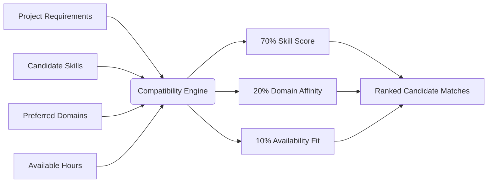
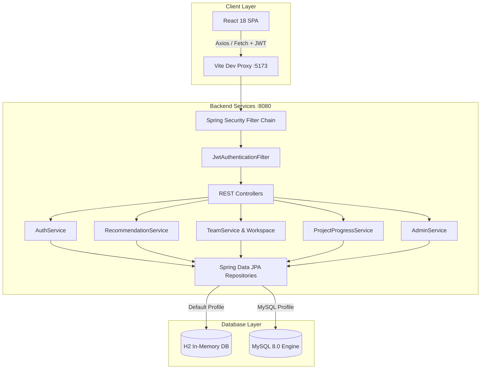

<div align="center">

# 🤝 ProjectPartner
### Academic Teammate & Project Discovery Platform

*Algorithmic skill matching, collaborative workspaces, and Agile sprint tracking for university students & researchers.*

<br/>

[](https://project-partner-7b474t7bu-shreya-b515.vercel.app/)
[](#-testing--quality-assurance)
[](https://spring.io/projects/spring-boot)
[](https://www.java.com/)
[](https://react.dev/)
[](https://vitejs.dev/)
[](#-database-modes)
[](#-security--authentication)
[](LICENSE)

<br/>

[🌐 Live Demo](https://project-partner-7b474t7bu-shreya-b515.vercel.app/) • [🚀 Quick Start](#-getting-started) • [🌟 Core Features](#-key-features) • [🧠 Matching Algorithm](#-algorithmic-matchmaking-engine) • [👥 Demo Personas](#-pre-seeded-demo-personas) • [📡 REST API](#-rest-api-documentation) • [🏛️ Architecture](#-system-architecture)

---

</div>

<br/>

## 🌐 Live Production Deployment

Experience the live application deployed on the cloud:

| Component | Platform | Live URL | Status |
| :--- | :--- | :--- | :--- |
| **Frontend Web App** | **Vercel** | [https://project-partner-7b474t7bu-shreya-b515.vercel.app/](https://project-partner-7b474t7bu-shreya-b515.vercel.app/) |  |
| **Backend REST API** | **Render (Docker)** | Cloud Container Service |  |

> [!TIP]
> **Try it immediately**: Open the [Live Demo](https://project-partner-7b474t7bu-shreya-b515.vercel.app/) and explore using the **Persona Switcher** in the top navigation bar or log in with one of our [Pre-seeded Demo Personas](#-pre-seeded-demo-personas) to test student and admin workspaces instantly without registering.

<br/>

---

## 📖 Overview

**ProjectPartner** solves one of the most persistent challenges in higher education: **finding the right teammates for academic capstones, hackathons, and research initiatives.**

Instead of relying on random group assignments or manual bulletin boards, **ProjectPartner** leverages a weighted algorithmic matchmaking engine that scores candidates based on complementary skill requirements, domain affinities, and availability schedules. It provides students with full sprint workspaces, milestone tracking, and an interactive Kanban board to take their project from inception to deployment.

<br/>

---

## 🌟 Key Features

```
┌──────────────────────────────────────────────────────────────────────────────────┐
│                                PROJECTPARTNER ECOSYSTEM                          │
├────────────────────────────┬────────────────────────────┬────────────────────────┤
│  🎯 Matchmaking Engine    │💼 Collaborative Workspace  │  🛡️ Admin Governance   │
│  • Weighted Skill Scoring  │  • Agile Kanban Board      │  • Real-Time Metrics   │
│  • Domain Affinity Match   │  • Sprint Milestone Tracker│  • User Moderation     │
│  • Availability Balancing  │  • Internal Bulletin Board │  • Project Oversight   │
│  • Candidate Filtering     │  • Bi-directional Invites  │  • Skill Dictionary    │
└────────────────────────────┴────────────────────────────┴────────────────────────┘
```

### 1. 🧠 Algorithmic Teammate Matching & Discovery
- Computes compatibility score (0% to 100%) against project requirements.
- Color-coded visual affinity badges: **Emerald (85%+)**, **Indigo (70-84%)**, and **Amber (50-69%)**.
- Highlights overlapping skills, missing required skills, and personalized rationale for every recommendation.
- Instant filters by **technical skill**, **university department**, and **minimum hours per week**.

### 2. 👥 Bi-Directional Team Recruitment Lifecycle
- **Join Applications**: Students submit structured project pitches to project leads.
- **Direct Invitations**: Project leads send invitations with customized roles to top-scoring candidates.
- Automated roster integration: Accepting a request automatically registers the student in the project roster, assigns their role, and decrements available project slots.

### 3. 📋 Agile Sprint & Kanban Board
- 4-column sprint board: `To Do` ➔ `In Progress` ➔ `Under Review` ➔ `Completed`.
- Task prioritization tags (`LOW`, `MEDIUM`, `HIGH`, `URGENT`) with milestone associations and team assignees.
- Milestone deadlines with completion timestamps and live progress calculations.

### 4. 🎓 Rich Student Profiles & Showcase
- Academic credentials: Degree, university, department, graduation year, and weekly hours.
- 35+ technical skills categorized into 8 domains with 4-tier ratings (`BEGINNER`, `INTERMEDIATE`, `ADVANCED`, `EXPERT`).
- Past project portfolio showcase with repository and live demo links.

### 5. 🛡️ Dedicated Superadmin Governance Portal
- Isolated console for administrators (`ROLE_ADMIN`) with high-level platform health metrics.
- Domain and skill popularity distribution charts.
- Account status toggling (active / suspended) with cascade unlinking.
- Content moderation and global skill dictionary management.

<br/>

---

## 🧠 Algorithmic Matchmaking Engine

The compatibility scoring engine uses a weighted model taking into account three orthogonal dimensions:

$$\text{MatchScore} = \left( \frac{\sum_{s \in S_{\text{matched}}} W(s)}{\sum_{s \in S_{\text{required}}} W_{\text{max}}(s)} \times 70\% \right) + (\text{DomainOverlap} \times 20\%) + (\text{AvailabilityFit} \times 10\%)$$



### 1. Skill Proficiency Factor (70% Weight)
- Each skill level corresponds to an integer weight:
  - `BEGINNER`: 1 | `INTERMEDIATE`: 2 | `ADVANCED`: 3 | `EXPERT`: 4
- Mandatory skills carry a **1.5× importance multiplier**.
- Partial score awarded if candidate meets or exceeds the required threshold:
  $$\text{Awarded} = \min\left(1.0, \frac{\text{CandidateWeight}}{\text{RequiredWeight}}\right) \times \text{RequiredWeight} \times \text{Multiplier}$$

### 2. Domain Affinity (20% Weight)
- Grants full 20% bonus when student's preferred research or engineering domains overlap with the project's domain category (`AI_MACHINE_LEARNING`, `WEB_DEVELOPMENT`, `MOBILE_APPS`, `CYBERSECURITY`, `CLOUD_DEVOPS`, `DATA_SCIENCE`, `IOT_EMBEDDED`, `BLOCKCHAIN`).

### 3. Availability Schedule (10% Weight)
- $\ge 15\text{ hrs/week} \implies 10\%$
- $10 - 14\text{ hrs/week} \implies 7\%$
- $< 10\text{ hrs/week} \implies 4\%$

<br/>

---

## 🛠️ Technology Stack

| Layer | Technologies | Description |
|---|---|---|
| **Backend Framework** | Spring Boot 2.7.18 | Stateless enterprise REST architecture |
| **Language** | Java 8+ / 17 / 21 | Compatible with legacy and modern Java runtimes |
| **Security & Auth** | Spring Security + JJWT 0.11.5 | Salted BCrypt password hashing + Bearer JWT tokens |
| **Persistence & ORM** | Spring Data JPA + Hibernate 5.6 | Declarative repositories, lazy associations, transactional cascades |
| **Database** | MySQL 8.0 & H2 In-Memory | Production MySQL support with zero-config H2 dev fallback |
| **Frontend Framework** | React 18 + Vite 5+ | Fast HMR dev server & optimized production bundles |
| **Styling & UI** | Vanilla CSS Grid & Glassmorphism | Custom design tokens, dark/light themes, micro-animations |
| **Icons & Visuals** | Lucide React | Consistent modern iconography |
| **Build & Tooling** | Bundled Apache Maven 3.8.8 | Non-interactive maven wrapper (`mvnw.cmd`) |

<br/>

---

## 👥 Pre-Seeded Demo Personas

The platform comes pre-seeded with realistic student and administrator accounts. You can instantly switch between them using the **"Switch Persona"** menu in the top navigation bar:

| Avatar | Name | Role & Specialty | Email | Password |
|:---:|---|---|---|:---:|
| 👩‍💻 | **Sarah Jenkins** | AI Specialist & Project Lead (*Campus Companion*) | `sarah@campus.edu` | `password123` |
| 👨‍💻 | **Alex Chen** | Full Stack Lead & Project Lead (*CampusPay*) | `alex@campus.edu` | `password123` |
| 🎨 | **Priya Patel** | UI/UX Designer & Project Lead (*HealthSync*) | `priya@campus.edu` | `password123` |
| 🔬 | **Elena Rostova** | Candidate (NLP Researcher) | `elena@campus.edu` | `password123` |
| ⚙️ | **Marcus Vance** | Backend Specialist (Spring Boot / Docker) | `marcus@campus.edu` | `password123` |
| 📱 | **David Kim** | Mobile App Developer (Flutter / iOS) | `david@campus.edu` | `password123` |
| 🛡️ | **Platform Administrator** | System Administrator (Admin Console) | `admin@projectpartner.com` | `admin123` |

<br/>

---

## 🚀 Getting Started

### Prerequisites
- **Java**: JDK 8, 17, or 21 installed.
- **Node.js**: v18 or higher with `npm`.

---

### Step 1: Start the Backend (Spring Boot)

The repository includes a bundled Maven wrapper. Run the following command from the project root:

```powershell
# Windows PowerShell
.\backend\mvnw.cmd spring-boot:run -f backend/pom.xml
```

```bash
# macOS / Linux
mvn spring-boot:run -f backend/pom.xml
```

The Spring Boot backend will start at:
👉 **`http://localhost:8080`**

#### 💾 Database Modes:
- **H2 In-Memory (Default)**: Runs out-of-the-box with zero installation. All demo students, projects, and skills are automatically seeded.
  - H2 Web Console: [http://localhost:8080/h2-console](http://localhost:8080/h2-console)  
    *(JDBC URL: `jdbc:h2:mem:projectpartner_db`, User: `sa`, Password: empty)*
- **MySQL 8 Mode**: To connect to a local MySQL database:
  ```powershell
  $env:SPRING_PROFILES_ACTIVE = "mysql"
  $env:DB_PASSWORD = "your_mysql_password"
  .\backend\mvnw.cmd spring-boot:run -f backend/pom.xml
  ```

---

### Step 2: Start the Frontend (React + Vite)

Open a new terminal window:

```powershell
cd frontend
npm install
npm run dev
```

The React frontend will start at:
👉 **`http://localhost:5173`**

*(The Vite development server is configured to proxy all `/api` requests directly to `http://localhost:8080`.)*

<br/>

---

## 🏛️ System Architecture



<br/>

---

## 📡 REST API Documentation

### 🔐 Authentication (`/api/auth`)
| Method | Endpoint | Description | Auth Required |
|:---:|---|---|:---:|
| `POST` | `/api/auth/register` | Register a new student profile | No |
| `POST` | `/api/auth/login` | Authenticate and obtain JWT Bearer token | No |
| `GET` | `/api/auth/me` | Retrieve authenticated user session | Yes |

### 🎓 Profiles & Skills (`/api/profiles`, `/api/skills`)
| Method | Endpoint | Description | Auth Required |
|:---:|---|---|:---:|
| `GET` | `/api/profiles/me` | Current user's profile and skills | Yes |
| `PUT` | `/api/profiles/me` | Update bio, university, and availability | Yes |
| `GET` | `/api/profiles/{userId}` | Public profile of student | No |
| `POST` | `/api/profiles/me/skills` | Add or update technical skill proficiency | Yes |
| `DELETE` | `/api/profiles/me/skills/{id}` | Remove skill proficiency | Yes |
| `POST` | `/api/profiles/me/projects` | Add past portfolio showcase project | Yes |
| `DELETE` | `/api/profiles/me/projects/{id}` | Delete showcase project | Yes |
| `GET` | `/api/skills` | List platform skill dictionary | No |

### 🎯 Skill Matching & Recommendations (`/api/recommendations`)
| Method | Endpoint | Description | Auth Required |
|:---:|---|---|:---:|
| `GET` | `/api/recommendations/teammates/{projectId}` | Algorithmic teammate recommendations (`?skill=&department=&minHours=`) | Yes |
| `GET` | `/api/recommendations/projects` | Recommended open projects for current user | Yes |

### 🤝 Team Requests & Invitations (`/api/team-requests`)
| Method | Endpoint | Description | Auth Required |
|:---:|---|---|:---:|
| `POST` | `/api/team-requests` | Send join application or teammate invitation | Yes |
| `POST` | `/api/team-requests/{id}/respond` | Accept or reject request (`?accept=true/false`) | Yes |
| `POST` | `/api/team-requests/{id}/cancel` | Cancel outgoing pending request | Yes |
| `GET` | `/api/team-requests/incoming` | List incoming applications and invitations | Yes |
| `GET` | `/api/team-requests/outgoing` | List outgoing applications and invitations | Yes |

### 📁 Projects & Workspace (`/api/projects`, `/api/progress`)
| Method | Endpoint | Description | Auth Required |
|:---:|---|---|:---:|
| `GET` | `/api/projects` | Search open projects with filters | No |
| `GET` | `/api/projects/{id}` | Full project details, team roster & requirements | No |
| `POST` | `/api/projects` | Create a new project posting | Yes |
| `PATCH` | `/api/projects/{id}/status` | Update status (`RECRUITING`, `IN_PROGRESS`, etc.) | Yes |
| `DELETE` | `/api/projects/{id}/members/{userId}` | Remove team member (Leader only) | Yes |
| `DELETE` | `/api/projects/{id}` | Delete project posting (Leader/Admin only) | Yes |
| `GET` | `/api/progress/{id}/milestones` | Get milestone roadmap | Yes |
| `POST` | `/api/progress/{id}/milestones` | Create milestone | Yes |
| `GET` | `/api/progress/{id}/tasks` | Sprint Kanban tasks | Yes |
| `POST` | `/api/progress/{id}/tasks` | Create Kanban task card | Yes |
| `PATCH` | `/api/progress/tasks/{id}/status` | Move task (`TODO`, `IN_PROGRESS`, `REVIEW`, `DONE`) | Yes |
| `GET` | `/api/progress/{id}/messages` | Team discussion messages | Yes |
| `POST` | `/api/progress/{id}/messages` | Post message to team board | Yes |

### 🛡️ Administration Console (`/api/admin`)
| Method | Endpoint | Description | Auth Required |
|:---:|---|---|:---:|
| `GET` | `/api/admin/stats` | Platform metrics & distribution charts | `ROLE_ADMIN` |
| `GET` | `/api/admin/users` | Student directory & status | `ROLE_ADMIN` |
| `PATCH` | `/api/admin/users/{id}/toggle-status` | Suspend or activate user account | `ROLE_ADMIN` |
| `DELETE` | `/api/admin/users/{id}` | Cascade delete account & associations | `ROLE_ADMIN` |
| `DELETE` | `/api/admin/projects/{id}` | Moderate and delete project posting | `ROLE_ADMIN` |
| `POST` | `/api/admin/skills` | Add new skill to global dictionary | `ROLE_ADMIN` |
| `DELETE` | `/api/admin/skills/{id}` | Delete skill from dictionary | `ROLE_ADMIN` |

<br/>

---

## 🧪 Testing & Quality Assurance

Run the automated backend test suite using the bundled Maven wrapper:

```powershell
.\backend\mvnw.cmd test -f backend/pom.xml
```

```
[INFO] -------------------------------------------------------
[INFO]  T E S T S
[INFO] -------------------------------------------------------
[INFO] Running com.projectpartner.ProjectPartnerApplicationTests
[INFO] Tests run: 6, Failures: 0, Errors: 0, Skipped: 0, Time elapsed: 17.155 s
[INFO] 
[INFO] BUILD SUCCESS
```

Tests validate:
- ✅ **Authentication**: User registration, password hashing, and token issuance.
- ✅ **Recommendation Engine**: Verification that suspended students are never recommended.
- ✅ **Milestones**: Automatic completion timestamp recording.
- ✅ **Cascade Safety**: Safe cascade cleanup of user tasks, requests, and messages on account deletion.
- ✅ **Request Integrity**: Bidirectional duplicate request prevention.

<br/>

---

## 📂 Project Structure

```
Project-partner/
├── backend/
│   ├── mvnw.cmd                              # Maven Wrapper for Windows
│   ├── pom.xml                               # Spring Boot & dependencies
│   └── src/
│       ├── main/
│       │   ├── java/com/projectpartner/
│       │   │   ├── config/                   # Seed DataInitializer & Spring config
│       │   │   ├── controller/               # REST API Endpoints
│       │   │   ├── dto/                      # Data Transfer Objects
│       │   │   ├── model/                    # JPA Entities (User, Project, Skill, Task)
│       │   │   ├── repository/               # Spring Data JPA Repositories
│       │   │   ├── security/                 # JWT Provider & Security Configuration
│       │   │   └── service/                  # Business Logic & Matching Engine
│       │   └── resources/
│       │       ├── application.properties    # Base configuration
│       │       ├── application-h2.properties # In-memory dev database profile
│       │       └── application-mysql.properties
│       └── test/                             # Automated JUnit 5 integration tests
├── frontend/
│   ├── package.json                          # Vite, React 18, Lucide React
│   ├── vite.config.js                        # Proxy configuration (:5173 -> :8080)
│   └── src/
│       ├── components/                       # Navbar, Sidebar, Modals, Badges
│       ├── context/                          # AuthContext & ThemeContext
│       ├── pages/                            # Dashboard, MatchFinder, Projects, Kanban, Admin
│       ├── services/api.js                   # REST Client API service
│       ├── App.jsx                           # Route & role-based container
│       └── index.css                         # Design system & dark mode tokens
└── README.md
```

<br/>

---

## 📄 License

This project is licensed under the [MIT License](LICENSE).

---

<div align="center">
  <sub>Built with ❤️ by Shreya Patil for collaborative student project success.</sub>
</div>
